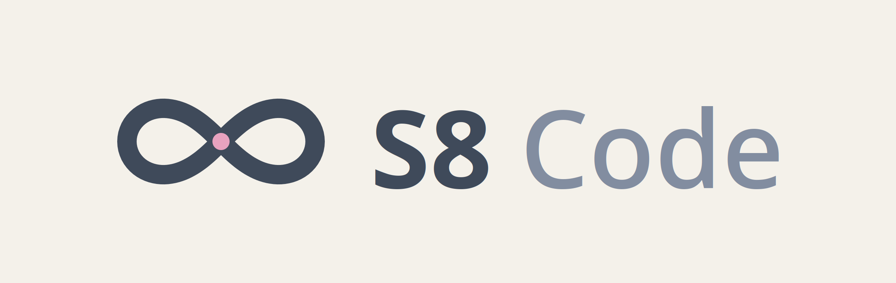

# S8 Code



**S8 Code** (Side8) is a personal fork of [T3 Code](https://github.com/pingdotgg/t3code). The name is an 8 on its side: ∞.

It keeps upstream's workflow and adds the changes needed to run it as my own tool, on my own machines. This is an unofficial fork, not affiliated with the upstream project.

[日本語 README](README.md)

## What is different from upstream

- **No telemetry egress**: analytics reporting (PostHog and friends) and the official update path are removed. The desktop auto-updater is kept, pointed at this fork's own feed. Diagnostics never leave the local machine.
- **End-to-end encryption**: E2EE covers the relay conversation channel (WebSocket RPC) plus `/mcp` and terminal streams (Device Hub). The server's identity is pinned by the fingerprint shown at pairing time. See [docs/internals/e2ee.md](docs/internals/e2ee.md).
- **Custom provider wizard**: the Add Provider dialog can register Anthropic-compatible relays (through Claude Code) and OpenAI-compatible endpoints (through Kilo Code) from the GUI. API keys are stored as sensitive variables and never land in a config file in plain text.
- **Key pairing**: devices pair with Ed25519 keys.
- **Server binding**: `--host` / `--port` choose where the server listens, and external agents can drive it through its MCP server (`/mcp`).

## Platform and builds

Based on upstream Stable **v0.1.13**.

The Linux desktop app is built by GitHub Actions (`build-desktop-linux.yml`) and ships as a `.deb` and an AppImage.

```sh
# Development
pnpm install
vp run --filter=t3 dev
```

## License and credits

- Licensed under the **MIT** License, same as upstream ([LICENSE](LICENSE)).
- The original project is **T3 Code** by T3 Tools Inc. and its contributors; this fork keeps their copyright notices.
- The "T3 Code" name, logos and other trademarks belong to T3 Tools Inc. S8 Code is an unofficial fork and is not affiliated with or endorsed by them (see [TRADEMARK.md](TRADEMARK.md)).
