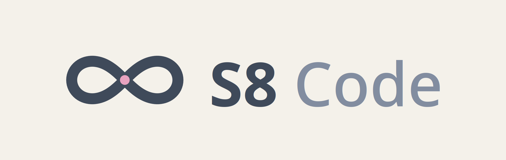

# S8 Code



**S8 Code**（Side8）は、[T3 Code](https://github.com/pingdotgg/t3code) の個人フォークです。名前の由来は「横倒しの 8 = ∞」。

上流の使い勝手はそのままに、自分の環境で自分の道具として使うための変更を入れています。公式版とは無関係の非公式フォークです。

[English README](README.en.md)

## 上流との違い

- **テレメトリ送信なし**: PostHog 等の解析送信と、公式アップデート経路を撤去しました（デスクトップの自動アップデートだけは、このフォーク自身のフィードを向けて残しています）。診断情報はローカルの外に出ません。
- **エンドツーエンド暗号化**: リレー越しの会話チャネル（WebSocket RPC）に加えて、`/mcp` と端末ストリーム（Device Hub）まで E2EE を広げました。サーバーの身元はペアリング時の指紋で固定します。設計は [docs/internals/e2ee.md](docs/internals/e2ee.md)。
- **カスタムプロバイダー追加ウィザード**: プロバイダー追加画面から、Anthropic 互換リレー（Claude Code 経由）と OpenAI 互換エンドポイント（Kilo Code 経由）を GUI で登録できます。API キーは機密変数として保存され、設定ファイルに平文で残りません。
- **キー・ペアリング**: Ed25519 鍵によるデバイスのペアリングに対応。
- **サーバーの待ち受け指定**: `--host` / `--port` で待ち受け先を指定でき、MCP サーバー（`/mcp`）経由で外部のエージェントからも操作できます。

## 動作環境とビルド

ベースは上流の Stable **v0.1.13** です。

Linux デスクトップ版は GitHub Actions（`build-desktop-linux.yml`）でビルドします。成果物は `.deb` と AppImage です。

```sh
# 開発用
pnpm install
vp run --filter=t3 dev
```

## ライセンスとクレジット

- ライセンスは上流と同じ **MIT** です（[LICENSE](LICENSE)）。
- 元のプロジェクトは **T3 Code**（T3 Tools Inc. とコントリビューター）です。このフォークは上流の著作権表示を保持しています。
- 「T3 Code」の名称・ロゴ等の商標は T3 Tools Inc. に帰属します。S8 Code は非公式フォークであり、上流とは提携していません（[TRADEMARK.md](TRADEMARK.md)）。
